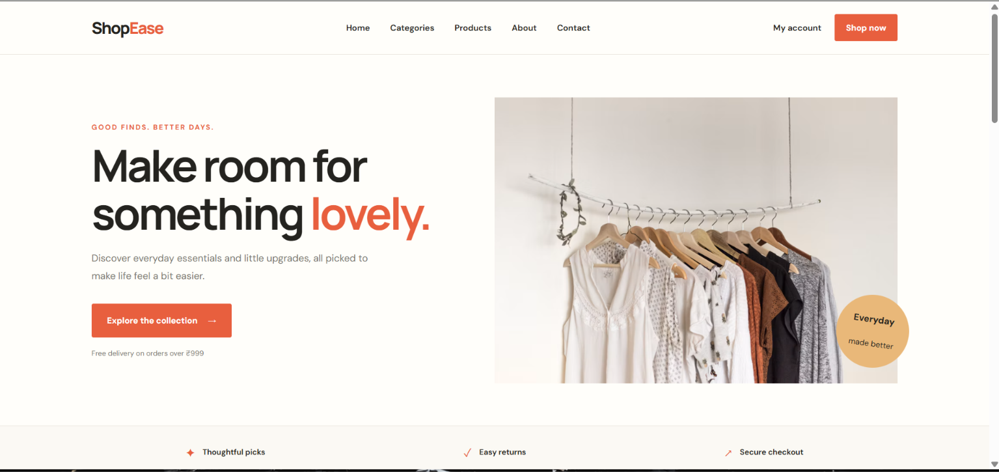
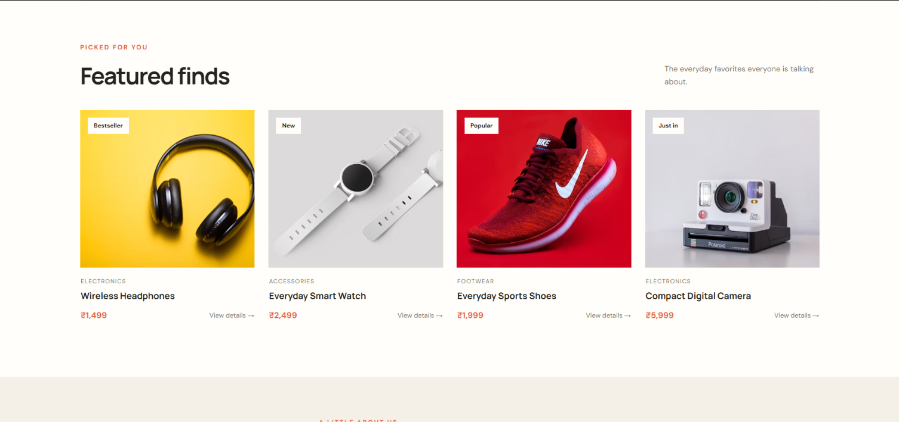
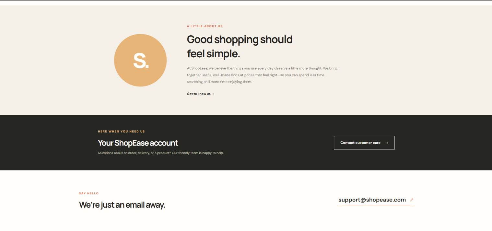

## Ex_02 Commercial Website 

Date: 11.02.2026
## AIM
To create a commercial website using CSS Flexbox.

## ALGORITHM :
STEP 1:
Create an HTML file (index.html)

STEP 2:
Create a CSS file (style.css)

STEP 3:
Include a navigation bar with links to different sections.

STEP 4:
Add structured sections for Homepage, Products / Services, About Us, Contact Details and User Account.

STEP 5:
Include social media links at the footer with copyright information.

STEP 6:
Define global styles for fonts, colors, and layout.

STEP 7:
Style the header, navigation bar, and sections.

STEP 8:
Use Flexbox for layout design.

STEP 9:
Add hover effects and transitions for interactivity.

STEP 10:
Add Images and Media.

STEP 11:
Use optimized images for a professional look.

STEP 12:
Open the HTML file in a browser to check layout and functionality.

STEP 13:
Fix styling issues and refine content placement.

STEP 14:
Deploy the website.

STEP 15:
Upload to GitHub Pages for free hosting.

## PROGRAM : 
index.html
```
<!DOCTYPE html>
<html lang="en">
<head>
    <meta charset="UTF-8">
    <meta name="viewport" content="width=device-width, initial-scale=1.0">
    <meta name="description" content="ShopEase brings together everyday essentials, thoughtful design, and great prices.">
    <title>ShopEase | Everyday finds, made easy</title>
    <link rel="stylesheet" href="style.css">
</head>
<body>
    <header class="site-header">
        <div class="header-inner">
            <a class="brand" href="#home" aria-label="ShopEase home">Shop<span>Ease</span></a>
            <nav aria-label="Main navigation">
                <a href="#home">Home</a>
                <a href="#categories">Categories</a>
                <a href="#products">Products</a>
                <a href="#about">About</a>
                <a href="#contact">Contact</a>
            </nav>
            <div class="header-actions">
                <a class="account-link" href="#account">My account</a>
                <a class="button button-small" href="#products">Shop now</a>
            </div>
        </div>
    </header>

    <main>
        <section class="hero" id="home">
            <div class="hero-content">
                <p class="eyebrow">Good finds. Better days.</p>
                <h1>Make room for<br>something <span>lovely.</span></h1>
                <p class="hero-copy">Discover everyday essentials and little upgrades, all picked to make life feel a bit easier.</p>
                <a class="button" href="#products">Explore the collection <span aria-hidden="true">→</span></a>
                <p class="hero-note">Free delivery on orders over ₹999</p>
            </div>
            <div class="hero-image-wrap">
                
                <div class="hero-sticker"><strong>Everyday</strong><br>made better</div>
            </div>
        </section>

        <section class="benefits" aria-label="Shopping benefits">
            <div><span aria-hidden="true">✦</span><p>Thoughtful picks</p></div>
            <div><span aria-hidden="true">✓</span><p>Easy returns</p></div>
            <div><span aria-hidden="true">↗</span><p>Secure checkout</p></div>
        </section>

        <section class="section categories-section" id="categories">
            <div class="section-heading">
                <div>
                    <p class="eyebrow">Find your thing</p>
                    <h2>Shop by category</h2>
                </div>
                <p class="section-intro">A little inspiration for every part of your day.</p>
            </div>
            <div class="categories">
                <a class="category-card category-electronics" href="#products">
                    <span class="category-number">01</span><span>Electronics</span><span class="category-arrow" aria-hidden="true">↗</span>
                </a>
                <a class="category-card category-fashion" href="#products">
                    <span class="category-number">02</span><span>Fashion</span><span class="category-arrow" aria-hidden="true">↗</span>
                </a>
                <a class="category-card category-footwear" href="#products">
                    <span class="category-number">03</span><span>Footwear</span><span class="category-arrow" aria-hidden="true">↗</span>
                </a>
                <a class="category-card category-accessories" href="#products">
                    <span class="category-number">04</span><span>Accessories</span><span class="category-arrow" aria-hidden="true">↗</span>
                </a>
            </div>
        </section>

        <section class="section products-section" id="products">
            <div class="section-heading">
                <div>
                    <p class="eyebrow">Picked for you</p>
                    <h2>Featured finds</h2>
                </div>
                <p class="section-intro">The everyday favorites everyone is talking about.</p>
            </div>
            <div class="products">
                <article class="product">
                    <div class="product-image">
                        
                        <span class="product-tag">Bestseller</span>
                    </div>
                    <div class="product-info">
                        <p class="product-category">Electronics</p>
                        <h3>Wireless Headphones</h3>
                        <div class="product-bottom"><p class="price">₹1,499</p><a href="#contact" aria-label="Ask about Wireless Headphones">View details <span aria-hidden="true">→</span></a></div>
                    </div>
                </article>
                <article class="product">
                    <div class="product-image">
                        
                        <span class="product-tag">New</span>
                    </div>
                    <div class="product-info">
                        <p class="product-category">Accessories</p>
                        <h3>Everyday Smart Watch</h3>
                        <div class="product-bottom"><p class="price">₹2,499</p><a href="#contact" aria-label="Ask about Everyday Smart Watch">View details <span aria-hidden="true">→</span></a></div>
                    </div>
                </article>
                <article class="product">
                    <div class="product-image">
                        
                        <span class="product-tag">Popular</span>
                    </div>
                    <div class="product-info">
                        <p class="product-category">Footwear</p>
                        <h3>Everyday Sports Shoes</h3>
                        <div class="product-bottom"><p class="price">₹1,999</p><a href="#contact" aria-label="Ask about Everyday Sports Shoes">View details <span aria-hidden="true">→</span></a></div>
                    </div>
                </article>
                <article class="product">
                    <div class="product-image">
                        
                        <span class="product-tag">Just in</span>
                    </div>
                    <div class="product-info">
                        <p class="product-category">Electronics</p>
                        <h3>Compact Digital Camera</h3>
                        <div class="product-bottom"><p class="price">₹5,999</p><a href="#contact" aria-label="Ask about Compact Digital Camera">View details <span aria-hidden="true">→</span></a></div>
                    </div>
                </article>
            </div>
        </section>

        <section class="about-section" id="about">
            <div class="about-mark" aria-hidden="true">S.</div>
            <div class="about-copy">
                <p class="eyebrow">A little about us</p>
                <h2>Good shopping should feel simple.</h2>
                <p>At ShopEase, we believe the things you use every day deserve a little more thought. We bring together useful, well-made finds at prices that feel right—so you can spend less time searching and more time enjoying them.</p>
                <a class="text-link" href="#contact">Get to know us <span aria-hidden="true">→</span></a>
            </div>
        </section>

        <section class="account-section" id="account">
            <div>
                <p class="eyebrow">Here when you need us</p>
                <h2>Your ShopEase account</h2>
                <p>Questions about an order, delivery, or a product? Our friendly team is happy to help.</p>
            </div>
            <a class="button button-light" href="mailto:support@shopease.com">Contact customer care <span aria-hidden="true">→</span></a>
        </section>

        <section class="contact-section section" id="contact">
            <div>
                <p class="eyebrow">Say hello</p>
                <h2>We’re just an email away.</h2>
            </div>
            <a class="contact-email" href="mailto:support@shopease.com">support@shopease.com <span aria-hidden="true">↗</span></a>
        </section>
    </main>

    <footer class="site-footer">
        <div class="footer-main">
            <div class="footer-brand">
                <a class="brand" href="#home">Shop<span>Ease</span></a>
                <p>Everyday finds, made easy.</p>
            </div>
            <div class="footer-links">
                <h2>Explore</h2>
                <a href="#products">Products</a>
                <a href="#categories">Categories</a>
                <a href="#about">About us</a>
            </div>
            <div class="footer-links">
                <h2>Get in touch</h2>
                <a href="mailto:support@shopease.com">Email us</a>
                <a href="#account">Customer care</a>
            </div>
            <div class="footer-social">
                <h2>Follow along</h2>
                <a href="https://www.instagram.com/" target="_blank" rel="noopener noreferrer">Instagram <span aria-hidden="true">↗</span></a>
                <a href="https://www.facebook.com/" target="_blank" rel="noopener noreferrer">Facebook <span aria-hidden="true">↗</span></a>
                <a href="https://www.pinterest.com/" target="_blank" rel="noopener noreferrer">Pinterest <span aria-hidden="true">↗</span></a>
            </div>
        </div>
        <div class="footer-bottom">
            <p>© 2026 ShopEase. All rights reserved.</p>
            <a href="#home">Back to top ↑</a>
        </div>
    </footer>
</body>
</html>
```
style.css
```
@import url("https://fonts.googleapis.com/css2?family=DM+Sans:wght@400;500;600;700&family=Manrope:wght@400;500;600;700;800&display=swap");

:root {
    font-family: "DM Sans", Arial, sans-serif;
    color: #24231f;
    background: #fffefa;
    font-synthesis: none;
    text-rendering: optimizeLegibility;
    --ink: #24231f;
    --muted: #77756e;
    --accent: #e85f3e;
    --cream: #f5f0e7;
    --line: #e9e5dc;
}

* {
    box-sizing: border-box;
}

html {
    scroll-behavior: smooth;
}

body {
    margin: 0;
    min-width: 320px;
}

a {
    color: inherit;
    text-decoration: none;
}

button,
a {
    -webkit-tap-highlight-color: transparent;
}

a:focus-visible {
    outline: 3px solid #e85f3e;
    outline-offset: 4px;
}

.site-header {
    background: #fffefa;
    border-bottom: 1px solid var(--line);
}

.header-inner {
    width: min(1240px, calc(100% - 64px));
    min-height: 82px;
    margin: 0 auto;
    display: flex;
    align-items: center;
    justify-content: space-between;
    gap: 30px;
}

.brand {
    font-family: "Manrope", Arial, sans-serif;
    font-size: 25px;
    font-weight: 800;
    letter-spacing: -1.5px;
}

.brand span {
    color: var(--accent);
}

nav,
.header-actions {
    display: flex;
    align-items: center;
}

nav {
    gap: 31px;
}

nav a,
.account-link {
    font-size: 13px;
    font-weight: 600;
    transition: color 180ms ease;
}

nav a:hover,
.account-link:hover {
    color: var(--accent);
}

.header-actions {
    gap: 20px;
}

.button {
    min-height: 52px;
    padding: 0 23px;
    border: 1px solid var(--accent);
    border-radius: 3px;
    display: inline-flex;
    align-items: center;
    justify-content: center;
    gap: 16px;
    background: var(--accent);
    color: #fff;
    font-size: 13px;
    font-weight: 700;
    transition: background 180ms ease, color 180ms ease, transform 180ms ease;
}

.button:hover {
    background: #c94b2e;
    border-color: #c94b2e;
    transform: translateY(-2px);
}

.button-small {
    min-height: 42px;
    padding: 0 17px;
}

.hero {
    width: min(1240px, calc(100% - 64px));
    min-height: 570px;
    margin: 0 auto;
    padding: 58px 0;
    display: flex;
    align-items: center;
    justify-content: space-between;
    gap: 48px;
}

.hero-content {
    flex: 1 1 48%;
    padding: 24px 0;
}

.eyebrow {
    margin: 0 0 14px;
    color: var(--accent);
    font-size: 11px;
    font-weight: 700;
    letter-spacing: 1.8px;
    text-transform: uppercase;
}

h1,
h2,
h3,
p {
    margin-top: 0;
}

h1,
h2 {
    font-family: "Manrope", Arial, sans-serif;
}

.hero h1 {
    margin-bottom: 20px;
    font-size: clamp(42px, 5.3vw, 68px);
    line-height: 1.08;
    letter-spacing: -3.4px;
}

.hero h1 span {
    color: var(--accent);
}

.hero-copy {
    max-width: 440px;
    margin-bottom: 29px;
    color: var(--muted);
    font-size: 15px;
    line-height: 1.8;
}

.hero-note {
    margin: 17px 0 0;
    color: var(--muted);
    font-size: 11px;
}

.hero-image-wrap {
    position: relative;
    flex: 1 1 52%;
    height: 440px;
    background: var(--cream);
}

.hero-image {
    width: 100%;
    height: 100%;
    display: block;
    object-fit: cover;
    object-position: center 38%;
}

.hero-sticker {
    position: absolute;
    right: -17px;
    bottom: 24px;
    width: 112px;
    height: 112px;
    border-radius: 50%;
    display: flex;
    flex-direction: column;
    align-items: center;
    justify-content: center;
    background: #e9b879;
    color: var(--ink);
    font-size: 12px;
    line-height: 1.5;
    text-align: center;
    transform: rotate(8deg);
}

.hero-sticker strong {
    font-size: 14px;
}

.benefits {
    min-height: 82px;
    padding: 15px max(32px, calc((100% - 950px) / 2));
    border-top: 1px solid var(--line);
    border-bottom: 1px solid var(--line);
    display: flex;
    justify-content: space-between;
    align-items: center;
    gap: 24px;
    background: #fbf9f4;
}

.benefits div {
    display: flex;
    align-items: center;
    gap: 11px;
}

.benefits span {
    color: var(--accent);
    font-size: 18px;
}

.benefits p {
    margin: 0;
    font-size: 12px;
    font-weight: 600;
}

.section {
    width: min(1240px, calc(100% - 64px));
    margin: 0 auto;
}

.categories-section,
.products-section {
    padding-top: 91px;
    padding-bottom: 94px;
}

.products-section {
    padding-top: 70px;
    border-top: 1px solid var(--line);
}

.section-heading {
    margin-bottom: 31px;
    display: flex;
    align-items: end;
    justify-content: space-between;
    gap: 28px;
}

.section-heading h2,
.about-copy h2,
.account-section h2,
.contact-section h2 {
    margin-bottom: 0;
    font-size: clamp(28px, 3.2vw, 39px);
    letter-spacing: -1.6px;
}

.section-intro {
    max-width: 260px;
    margin-bottom: 5px;
    color: var(--muted);
    font-size: 13px;
    line-height: 1.7;
}

.categories {
    display: flex;
    flex-wrap: wrap;
    gap: 15px;
}

.category-card {
    position: relative;
    min-height: 175px;
    flex: 1 1 220px;
    padding: 20px;
    overflow: hidden;
    display: flex;
    flex-direction: column;
    justify-content: space-between;
    background: #efe7d9;
    transition: transform 200ms ease, filter 200ms ease;
}

.category-card:hover {
    filter: saturate(1.12);
    transform: translateY(-4px);
}

.category-card > span:nth-child(2) {
    position: relative;
    z-index: 1;
    font-family: "Manrope", Arial, sans-serif;
    font-size: 19px;
    font-weight: 700;
}

.category-number {
    color: #565044;
    font-size: 10px;
    font-weight: 700;
}

.category-arrow {
    position: absolute;
    right: 18px;
    bottom: 17px;
    font-size: 16px;
}

.category-electronics {
    background: #e8e4d8;
}

.category-fashion {
    background: #f2dfd5;
}

.category-footwear {
    background: #e5e9dd;
}

.category-accessories {
    background: #e7e1ed;
}

.products {
    display: flex;
    flex-wrap: wrap;
    gap: 23px;
}

.product {
    min-width: 220px;
    flex: 1 1 calc(25% - 18px);
}

.product-image {
    position: relative;
    height: 265px;
    overflow: hidden;
    background: #f2f0eb;
}

.product-image img {
    width: 100%;
    height: 100%;
    display: block;
    object-fit: cover;
    transition: transform 350ms ease;
}

.product:hover .product-image img {
    transform: scale(1.045);
}

.product-tag {
    position: absolute;
    top: 13px;
    left: 13px;
    padding: 7px 10px;
    background: #fffefa;
    font-size: 10px;
    font-weight: 700;
}

.product-info {
    padding: 17px 1px 0;
}

.product-category {
    margin-bottom: 7px;
    color: var(--muted);
    font-size: 10px;
    letter-spacing: 1px;
    text-transform: uppercase;
}

.product h3 {
    margin-bottom: 14px;
    font-family: "Manrope", Arial, sans-serif;
    font-size: 15px;
    font-weight: 700;
}

.product-bottom {
    display: flex;
    align-items: center;
    justify-content: space-between;
    gap: 8px;
}

.price {
    margin: 0;
    color: var(--accent);
    font-size: 14px;
    font-weight: 700;
}

.product-bottom a {
    color: var(--muted);
    font-size: 11px;
    transition: color 180ms ease;
}

.product-bottom a:hover,
.text-link:hover {
    color: var(--accent);
}

.about-section {
    min-height: 360px;
    padding: 70px max(32px, calc((100% - 980px) / 2));
    display: flex;
    align-items: center;
    gap: 75px;
    background: var(--cream);
}

.about-mark {
    width: 195px;
    height: 195px;
    flex: 0 0 195px;
    border-radius: 50%;
    display: flex;
    align-items: center;
    justify-content: center;
    background: #e7b578;
    color: #fffefa;
    font-family: "Manrope", Arial, sans-serif;
    font-size: 76px;
    font-weight: 800;
    letter-spacing: -8px;
}

.about-copy {
    max-width: 570px;
}

.about-copy h2 {
    max-width: 440px;
    margin-bottom: 17px;
}

.about-copy > p:not(.eyebrow) {
    margin-bottom: 20px;
    color: var(--muted);
    font-size: 13px;
    line-height: 1.9;
}

.text-link {
    font-size: 12px;
    font-weight: 700;
    transition: color 180ms ease;
}

.account-section {
    padding: 54px max(32px, calc((100% - 1100px) / 2));
    display: flex;
    align-items: center;
    justify-content: space-between;
    gap: 35px;
    background: #262722;
    color: #fffefa;
}

.account-section .eyebrow {
    color: #e9b879;
}

.account-section h2 {
    margin-bottom: 9px;
    font-size: 29px;
}

.account-section p:not(.eyebrow) {
    max-width: 510px;
    margin-bottom: 0;
    color: #c6c5bd;
    font-size: 12px;
    line-height: 1.7;
}

.button-light {
    flex: 0 0 auto;
    border-color: #fffefa;
    background: transparent;
    color: #fffefa;
}

.button-light:hover {
    border-color: #fffefa;
    background: #fffefa;
    color: var(--ink);
}

.contact-section {
    min-height: 225px;
    display: flex;
    align-items: center;
    justify-content: space-between;
    gap: 25px;
}

.contact-section h2 {
    font-size: 30px;
}

.contact-email {
    padding-bottom: 8px;
    border-bottom: 1px solid var(--accent);
    font-size: clamp(15px, 2.2vw, 21px);
    font-weight: 600;
    transition: color 180ms ease;
}

.contact-email:hover {
    color: var(--accent);
}

.contact-email span {
    margin-left: 8px;
    color: var(--accent);
}

.site-footer {
    padding: 54px max(32px, calc((100% - 1240px) / 2)) 20px;
    background: #262722;
    color: #fffefa;
}

.footer-main {
    padding-bottom: 45px;
    display: flex;
    justify-content: space-between;
    gap: 35px;
}

.footer-brand {
    min-width: 220px;
    flex: 1 1 30%;
}

.footer-brand p {
    margin-top: 10px;
    color: #c6c5bd;
    font-size: 12px;
}

.footer-links,
.footer-social {
    min-width: 125px;
    display: flex;
    flex-direction: column;
    gap: 12px;
}

.footer-links h2,
.footer-social h2 {
    margin-bottom: 4px;
    font-family: "DM Sans", Arial, sans-serif;
    font-size: 12px;
    font-weight: 700;
}

.footer-links a,
.footer-social a {
    color: #c6c5bd;
    font-size: 11px;
    transition: color 180ms ease;
}

.footer-links a:hover,
.footer-social a:hover,
.footer-bottom a:hover {
    color: #e9b879;
}

.footer-social a {
    display: flex;
    justify-content: space-between;
    gap: 15px;
}

.footer-bottom {
    padding-top: 18px;
    border-top: 1px solid #484943;
    display: flex;
    justify-content: space-between;
    gap: 20px;
    color: #c6c5bd;
    font-size: 10px;
}

.footer-bottom p {
    margin: 0;
}

.footer-bottom a {
    transition: color 180ms ease;
}

@media (max-width: 900px) {
    .header-inner {
        width: min(100% - 40px, 700px);
        flex-wrap: wrap;
        justify-content: center;
        gap: 15px 25px;
        padding: 17px 0;
    }

    .header-inner > .brand {
        margin-right: auto;
    }

    nav {
        order: 3;
        width: 100%;
        justify-content: center;
        gap: 24px;
    }

    .hero {
        width: min(100% - 48px, 760px);
        min-height: 480px;
        gap: 25px;
    }

    .hero-image-wrap {
        height: 360px;
    }

    .product {
        flex-basis: calc(50% - 12px);
    }

    .about-section {
        gap: 40px;
    }

    .footer-main {
        flex-wrap: wrap;
    }

    .footer-brand {
        flex-basis: 100%;
    }

    .footer-links,
    .footer-social {
        flex: 1 1 120px;
    }
}

@media (max-width: 600px) {
    .header-inner {
        width: calc(100% - 36px);
        justify-content: space-between;
        gap: 13px;
    }

    .header-inner > .brand {
        margin-right: 0;
    }

    .header-actions {
        gap: 12px;
    }

    .account-link {
        font-size: 11px;
    }

    .button-small {
        min-height: 37px;
        padding: 0 12px;
        font-size: 11px;
    }

    nav {
        justify-content: space-between;
        gap: 8px;
    }

    nav a {
        font-size: 11px;
    }

    .hero {
        width: calc(100% - 40px);
        padding: 42px 0 50px;
        flex-direction: column;
        align-items: stretch;
        gap: 25px;
    }

    .hero-content {
        padding: 0;
    }

    .hero h1 {
        font-size: clamp(40px, 12vw, 57px);
        letter-spacing: -2.7px;
    }

    .hero-copy {
        font-size: 13px;
    }

    .hero-image-wrap {
        height: 310px;
        margin-right: 10px;
    }

    .hero-sticker {
        right: -10px;
        width: 92px;
        height: 92px;
        font-size: 10px;
    }

    .benefits {
        padding: 19px 20px;
        flex-wrap: wrap;
        justify-content: center;
        gap: 14px 22px;
    }

    .benefits div {
        gap: 7px;
    }

    .benefits p {
        font-size: 10px;
    }

    .section {
        width: calc(100% - 40px);
    }

    .categories-section,
    .products-section {
        padding-top: 62px;
        padding-bottom: 62px;
    }

    .section-heading {
        align-items: start;
        flex-direction: column;
        gap: 10px;
    }

    .section-intro {
        max-width: 100%;
        margin: 0;
    }

    .categories {
        gap: 10px;
    }

    .category-card {
        min-height: 135px;
        flex-basis: calc(50% - 5px);
        padding: 14px;
    }

    .category-card > span:nth-child(2) {
        font-size: 15px;
    }

    .category-number {
        font-size: 9px;
    }

    .category-arrow {
        right: 12px;
        bottom: 12px;
        font-size: 13px;
    }

    .products {
        gap: 25px 12px;
    }

    .product {
        min-width: 0;
        flex-basis: calc(50% - 6px);
    }

    .product-image {
        height: clamp(150px, 48vw, 230px);
    }

    .product-info {
        padding-top: 12px;
    }

    .product h3 {
        min-height: 36px;
        font-size: 13px;
    }

    .product-tag {
        top: 8px;
        left: 8px;
        padding: 6px 7px;
        font-size: 9px;
    }

    .product-bottom {
        align-items: start;
        flex-direction: column;
        gap: 7px;
    }

    .about-section {
        padding: 48px 25px;
        flex-direction: column;
        align-items: flex-start;
        gap: 28px;
    }

    .about-mark {
        width: 115px;
        height: 115px;
        flex-basis: 115px;
        font-size: 50px;
    }

    .account-section {
        padding: 42px 25px;
        align-items: flex-start;
        flex-direction: column;
        gap: 22px;
    }

    .account-section h2,
    .contact-section h2 {
        font-size: 26px;
    }

    .contact-section {
        width: calc(100% - 40px);
        min-height: 190px;
        align-items: flex-start;
        justify-content: center;
        flex-direction: column;
        gap: 16px;
    }

    .site-footer {
        padding: 42px 22px 18px;
    }

    .footer-main {
        padding-bottom: 30px;
        flex-wrap: wrap;
        gap: 30px 20px;
    }

    .footer-brand {
        flex-basis: 100%;
    }

    .footer-links,
    .footer-social {
        flex: 1 1 calc(50% - 20px);
    }

    .footer-bottom {
        font-size: 9px;
    }
}

@media (prefers-reduced-motion: reduce) {
    *,
    *::before,
    *::after {
        scroll-behavior: auto !important;
        transition-duration: 0.01ms !important;
        animation-duration: 0.01ms !important;
        animation-iteration-count: 1 !important;
    }
}
```

## OUTPUT :


### Image Description







## RESULT :
The program for creating commercial website using CSS Flexbox is executed successfully.
